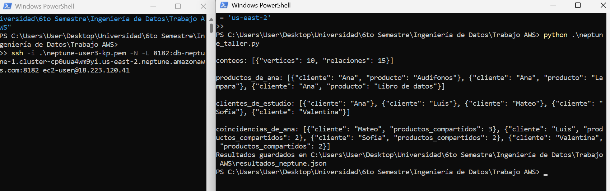
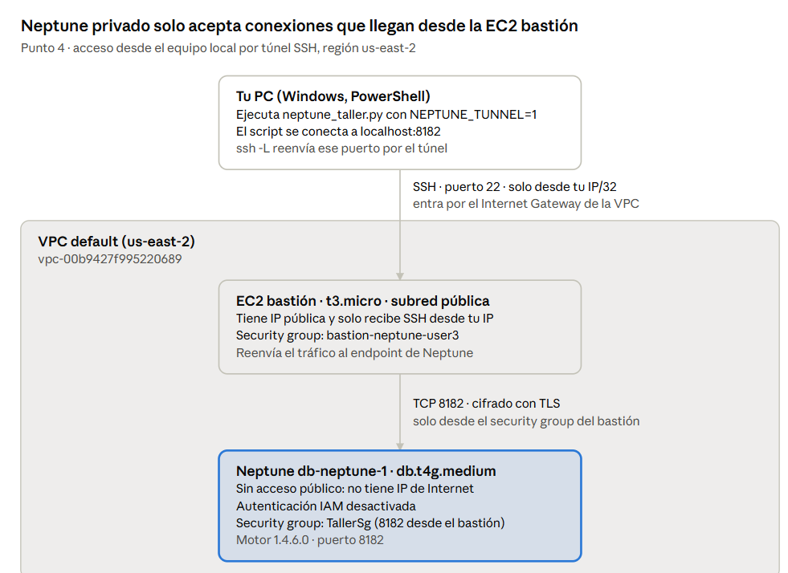

# Punto 4 · Amazon Neptune

Se desplegó un clúster Neptune aprovisionado (`db.t4g.medium`, motor 1.4.6.0) en **us-east-2**, se cargó un grafo de **10 vértices y 15 relaciones** y se ejecutaron **tres consultas openCypher desde Python** a través de un **túnel SSH por una EC2 bastión**. Primero se probó el endpoint público con autenticación IAM: la red funcionó, pero el usuario del curso no tenía permisos de datos (`neptune-db:*`), así que la conexión final se hizo con Neptune privado. Todos los recursos se eliminaron al terminar.

## Contenido de la carpeta

| Archivo | Qué es |
| --- | --- |
| `neptune_taller.py` | Crea el grafo y ejecuta las consultas (modo endpoint público o modo túnel con `NEPTUNE_TUNNEL=1`) |
| `diagnostico_neptune.py` | Revisa paso a paso credenciales, endpoint, DNS, puerto 8182 y permisos IAM |
| `resultados_neptune.json` | Resultados reales de la ejecución |
| `evidencias/` | Capturas numeradas (4.0 a 4.14) |

## 1. Neptune frente a Neo4j

| Aspecto | Amazon Neptune | Neo4j |
| --- | --- | --- |
| Modelo de datos | Grafo de propiedades y grafo RDF | Grafo de propiedades |
| Lenguajes | openCypher y Gremlin (propiedades), SPARQL (RDF) | Cypher |
| Herramientas | Consola de AWS, SDK (`neptunedata` de Boto3), Neptune Workbench (notebooks) | Neo4j Browser, Bloom, drivers oficiales |
| Operación | Servicio administrado: AWS gestiona almacenamiento replicado, copias y parches | Autogestionado o Neo4j Aura (administrado) |

openCypher facilita migrar consultas, pero Neptune no admite todas las funciones de Neo4j (por ejemplo los procedimientos APOC), así que una aplicación existente debe revisar compatibilidad de consultas y drivers.

## 2. Modalidad elegida y costo estimado

Se cotizó en AWS Pricing Calculator (us-east-2) antes de desplegar (capturas 4.0a y 4.0b):

| Modalidad | Configuración | Estimado |
| --- | --- | --- |
| Aprovisionado | 1 instancia `db.t4g.medium`, sin réplicas | 1,45 USD/mes según la cotización (incluye instancia, almacenamiento y E/S de la configuración cotizada) |
| Serverless | 1 NCU mínimo, 2 h de uso | ≈ 0,64 USD (cálculo manual, ver abajo) |

La calculadora de Serverless devolvió 0,00 USD porque toma las horas "inactivas" como 24 h sin cómputo, así que se calculó a mano:

| Concepto | Cálculo | Costo |
| --- | --- | --- |
| Cómputo a 1 NCU | 2 h × 1 NCU × 0,217 USD/NCU-h (tarifa mostrada por la calculadora) | 0,434 USD |
| Almacenamiento 10 GB | 10 × 0,10 USD × 2/730 h | ≈ 0,003 USD |
| E/S (1 millón de operaciones) | 1 × 0,20 USD | 0,20 USD |
| **Total** | | **≈ 0,64 USD** |

**Elección: aprovisionado `db.t4g.medium`.** Las dos cifras no están en la misma base: la cotización aprovisionada incluye el almacenamiento de un mes completo (10 GB × 0,10 = 1,00 USD) y la E/S (0,20 USD), mientras que la de Serverless prorratea el almacenamiento a 2 horas. Si se quitan esos dos conceptos, el cómputo aprovisionado de 2 h queda alrededor de 0,25 USD frente a 0,43 USD de Serverless a 1 NCU (valor aproximado, deducido de la cotización). Además, Serverless nunca baja de 1 NCU mientras el clúster existe, así que para una prueba corta con carga mínima la instancia `db.t4g.medium` resulta igual o más barata y su costo es fijo y predecible.

## 3. Acceso desde el equipo local

### Opción A · Endpoint público (probada primero)

Con motor 1.4.6.x Neptune permite un endpoint público. Se configuró así (capturas 4.1 a 4.4):

- **VPC:** la VPC por defecto `vpc-00b9427f995220689`, subredes en us-east-2a, 2b y 2c.
- **Rutas:** la tabla de rutas de las subredes tiene `172.31.0.0/16 → local` y `0.0.0.0/0 → Internet Gateway` (4.1).
- **Grupo de seguridad `TallerSg`:** entrada TCP 8182 solo desde la IP pública del equipo (/32) (4.2).
- **Autenticación:** IAM database authentication activada (obligatoria para el endpoint público); Boto3 firma cada petición con Signature Version 4.

La red funcionó (DNS público, puerto 8182 abierto), pero la consulta falló por permisos de datos del usuario del curso:

```
AccessDeniedException: User: arn:aws:iam::<ID-CUENTA>:user/de-gr01-user-3 is not authorized to perform
one or more of the actions: neptune-db:DeleteDataViaQuery, neptune-db:ReadDataViaQuery,
neptune-db:WriteDataViaQuery on resource: arn:aws:neptune-db:us-east-2:<ID-CUENTA>:cluster-G5Q4IPFBPZ6HUUJD2EEJM723B4/*
```

### Opción B · Túnel SSH por EC2 (opción usada)

Como los permisos `neptune-db` solo se evalúan cuando la autenticación IAM está activa, se pasó a Neptune privado con un bastión (capturas 4.7 a 4.13):

```
Equipo local ──SSH :22 (solo IP/32)──► Internet Gateway ──► EC2 bastión t3.micro (subred pública)
                                                               │  TCP 8182 (solo desde el SG del bastión)
                                                               ▼
                                              Neptune db-neptune-1 (sin IP pública, IAM desactivada)
```

| Elemento | Configuración |
| --- | --- |
| Neptune | *Accesible públicamente: No* (4.7) y *Autenticación IAM: No* (4.8) |
| EC2 bastión | `t3.micro`, Amazon Linux 2023, misma VPC, subred pública con IPv4 pública (4.9) |
| SG `bastion-neptune-user3` | Entrada SSH 22 solo desde la IP del equipo (4.10) |
| SG `TallerSg` | Nueva entrada TCP 8182 con origen el SG del bastión (4.11) |
| Túnel | `ssh -i llave.pem -N -L 8182:<endpoint-escritor>:8182 ec2-user@<IP-EC2>` (4.12) |
| Cifrado | TLS de Neptune dentro del túnel SSH. Como el certificado es de `*.neptune.amazonaws.com` y la conexión llega por `localhost`, el script no verifica el nombre del certificado en modo túnel |

### ¿Es necesario usar EC2? ¿Hay otra manera?

No siempre. Con motor 1.4.6 o posterior el **endpoint público** evita la EC2, a cambio de exigir autenticación IAM y permisos `neptune-db`. Otras alternativas sin abrir el puerto 22: **AWS Systems Manager Session Manager** con reenvío de puertos, una **VPN** hacia la VPC, o ejecutar el programa **dentro de la VPC** (EC2, Lambda o un notebook de Neptune Workbench). En este taller se necesitó la EC2 porque el usuario no tenía los permisos de datos que exige el endpoint público.

## 4. Modelo del grafo

| Tipo de vértice | Vértices |
| --- | --- |
| `Cliente` (5) | Ana, Luis, Sofia, Mateo, Valentina |
| `Producto` (3) | Libro de datos, Audifonos, Lampara |
| `Categoria` (2) | Estudio, Hogar |

| Relación | Cantidad | Detalle |
| --- | --- | --- |
| `(:Cliente)-[:COMPRO]->(:Producto)` | 12 | Ana: los 3 · Luis: libro, audífonos · Sofia: libro, lámpara · Mateo: los 3 · Valentina: audífonos, lámpara |
| `(:Producto)-[:PERTENECE_A]->(:Categoria)` | 3 | Libro → Estudio · Audífonos → Estudio · Lámpara → Hogar |

## 5. Cómo reproducirlo

Requisitos: Python 3.10+, `pip install --upgrade boto3 botocore`, AWS CLI v2 con un perfil autenticado (`aws login --profile taller-aws`).

1. Crear el clúster Neptune (consola → Neptune → Create database): motor 1.4.6.x, *Provisioned*, plantilla Desarrollo y pruebas, `db.t4g.medium`, sin réplicas, VPC por defecto, grupo de seguridad con TCP 8182.
2. **Con endpoint público:** activar *Public access* e *IAM database authentication*; el usuario necesita `neptune-db:ReadDataViaQuery` y `WriteDataViaQuery`.
3. **Con túnel (lo que se usó):**

```powershell
aws neptune modify-db-instance --db-instance-identifier db-neptune-1-instance-1 --no-publicly-accessible --apply-immediately
aws neptune modify-db-cluster --db-cluster-identifier db-neptune-1 --no-enable-iam-database-authentication --apply-immediately
# EC2 bastión t3.micro en la misma VPC, SG con SSH desde tu IP, y regla 8182 en el SG de Neptune desde el SG del bastión
ssh -i .\llave.pem -N -L 8182:<endpoint-escritor>:8182 ec2-user@<IP-EC2>
```

4. En otra ventana de PowerShell:

```powershell
$env:AWS_PROFILE = 'taller-aws'
$env:AWS_REGION = 'us-east-2'
$env:NEPTUNE_ENDPOINT = '<endpoint-escritor>'
$env:NEPTUNE_TUNNEL = '1'      # omitir si se usa el endpoint público
python .\neptune_taller.py
```

## 6. Consultas y resultados

Resultados reales (captura 4.5 y 4.12, archivo `resultados_neptune.json`):

| Consulta | Recorrido | Resultado |
| --- | --- | --- |
| `conteos` | Todos los vértices y relaciones | 10 vértices, 15 relaciones |
| `productos_de_ana` | Cliente → Producto | Audifonos, Lampara, Libro de datos |
| `clientes_de_estudio` | Cliente → Producto → Categoría | Ana, Luis, Mateo, Sofia, Valentina |
| `coincidencias_de_ana` | Cliente → Producto ← otro Cliente | Mateo 3 · Luis 2 · Sofia 2 · Valentina 2 productos compartidos |

```cypher
MATCH (c:Cliente)-[:COMPRO]->(p:Producto) WHERE c.nombre = 'Ana'
RETURN c.nombre AS cliente, p.nombre AS producto ORDER BY producto;

MATCH (c:Cliente)-[:COMPRO]->(p:Producto)-[:PERTENECE_A]->(k:Categoria) WHERE k.nombre = 'Estudio'
RETURN DISTINCT c.nombre AS cliente ORDER BY cliente;

MATCH (a:Cliente)-[:COMPRO]->(p:Producto)<-[:COMPRO]-(otro:Cliente)
WHERE a.nombre = 'Ana' AND otro.id <> a.id
RETURN otro.nombre AS cliente, count(DISTINCT p) AS productos_compartidos
ORDER BY productos_compartidos DESC, cliente;
```

**Interpretación:** Ana compró los tres productos del catálogo. Los cinco clientes compraron al menos un producto de *Estudio*, la categoría que llega a toda la base de clientes. Mateo compró exactamente lo mismo que Ana, así que es el cliente más parecido a ella; este recorrido Cliente → Producto ← Cliente es la base de una recomendación del tipo "clientes que compraron lo mismo que tú".

## 7. Preguntas de costos

- **¿Cuánto cuestan el cómputo y el almacenamiento?** En aprovisionado se paga la instancia por hora mientras esté encendida (cotización 4.0a: 1,45 USD/mes para la configuración evaluada); en Serverless, la capacidad en NCU por segundo (0,217 USD/NCU-h según la calculadora, mínimo 1 NCU). En ambos se suman almacenamiento (0,10 USD por GB-mes) y E/S (0,20 USD por millón de solicitudes, configuración Standard). Uso real del taller: la instancia estuvo encendida unas 5 horas en total (se detuvo mientras se esperaba respuesta del profesor) con menos de 1 GB de datos.
- **¿El método de conexión añade una EC2?** El endpoint público no. El túnel sí: una `t3.micro` (~0,0104 USD/h) más su IPv4 pública (~0,005 USD/h), ≈ 0,015 USD/h; se usó cerca de 1 hora.
- **¿Qué se sigue cobrando sin consultas?** La instancia aprovisionada mientras exista y esté encendida (o el mínimo de 1 NCU en Serverless), el almacenamiento del clúster, las instantáneas manuales y los recursos auxiliares: EC2, su volumen EBS y la IPv4 pública. Detener el clúster suspende el cobro de la instancia, pero AWS lo reinicia solo a los 7 días.

## 8. Eliminación de recursos

Se borraron, en este orden: instancia y clúster Neptune (sin snapshot final), EC2 bastión, grupos de seguridad `TallerSg` y `bastion-neptune-user3`, y el par de claves. Se comprobó que no quedaran clústeres ni instantáneas manuales y que la EC2 estuviera `terminated` (captura 4.14).

## 9. Evidencias

| N.º | Captura |
| --- | --- |
| 4.0a | Cotización Neptune aprovisionado |
| 4.0b | Cotización Neptune Serverless |
| 4.1a–c | Subredes de la VPC y tablas de rutas con Internet Gateway |
| 4.2 | Grupo de seguridad `TallerSg` (TCP 8182 desde la IP del equipo) |
| 4.3a–c | Configuración al crear el clúster (instancia, red y acceso público, autenticación IAM) |
| 4.4 | Clúster disponible y endpoints |
| 4.5 | Resultados de las consultas |
| 4.6 | Error del endpoint público (texto en la sección 3, opción A) |
| 4.7 | Neptune sin acceso público |
| 4.8 | Autenticación IAM desactivada |
| 4.9 | EC2 bastión |
| 4.10 | SG del bastión (SSH 22) |
| 4.11 | `TallerSg` con 8182 desde el SG del bastión |
| 4.12 | Túnel SSH abierto y script ejecutándose |
| 4.13 | Diagrama de arquitectura |
| 4.14 | Eliminación |



